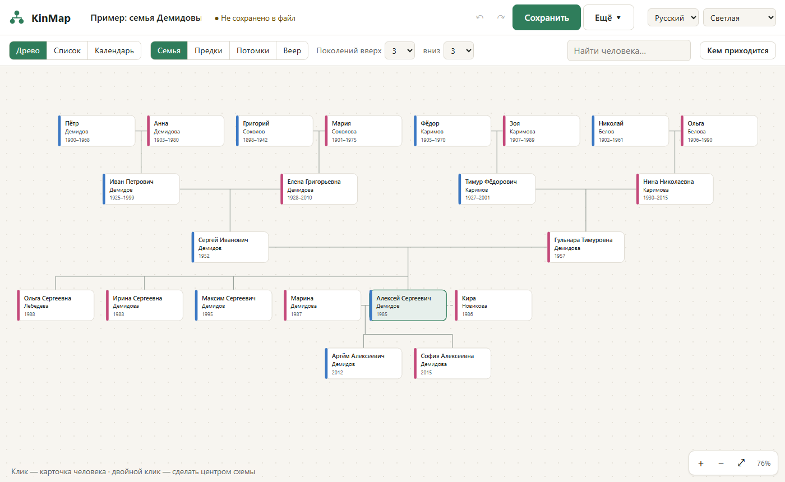
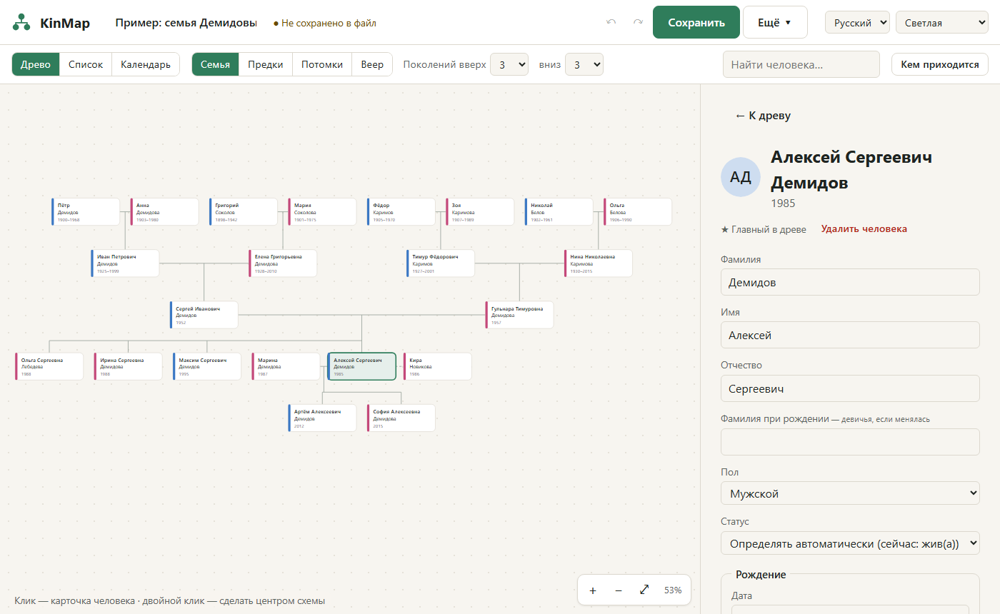
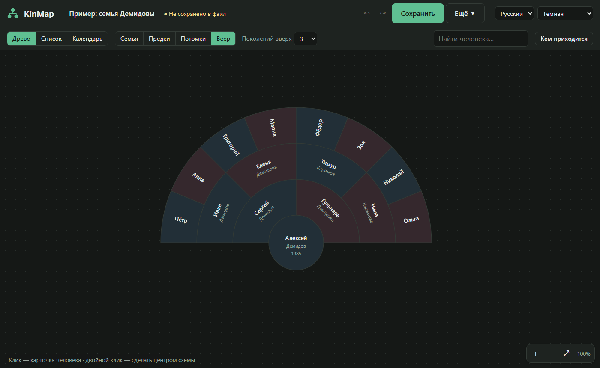

# KinMap

**Семейное древо в одном HTML-файле.** Скачайте файл, откройте двойным кликом — и работайте. Без регистрации, серверов и интернета: древо хранится только у вас.

**A family tree in a single HTML file.** Download, double-click, done. No sign-up, no servers, no internet — your data stays on your device. [English below ↓](#english)



## Как начать

1. Скачайте **`KinMap.html`** со страницы [Releases](../../releases/latest).
2. Откройте его двойным кликом — в Chrome, Edge, Firefox или Safari.
3. Нажмите «Создать новое древо», «Открыть файл древа» (подходит и GEDCOM из MyHeritage, Geni, Gramps) или «Посмотреть пример».

Интернет не нужен ни для установки, ни для работы. Файл можно положить на флешку и открыть на любом компьютере.

## Возможности

| | |
|---|---|
| 🌳 **Схема древа** | Виды «Семья» (предки сверху, потомки снизу), «Предки», «Потомки», «Веер». Масштаб колесом и пальцами, поиск, двойной клик — сделать человека центром. Повторные браки, разводы, приёмные дети, браки между родственниками |
| 🔗 **Кем приходится** | Выберите двух людей — KinMap назовёт родство в обе стороны: деверь, золовка, шурин, свояченица, сват, ятровка, двоюродный дедушка, внучатый племянник, троюродная сестра… Если точного слова нет — описание: «жена брата жены» |
| 🖼 **Фото и биография** | Фото сжимаются, данные о месте съёмки (GPS) удаляются. Круглый аватар с выбором области. Профессия, биография, неточные даты: «ок. 1950», «до 1920», «между 1900 и 1905» |
| ✅ **Проверка ошибок** | «Мать младше ребёнка», «родился после смерти матери», возможные дубликаты — 13 видов замечаний. Неточные даты не дают ложных тревог |
| 🖨 **Печать и PDF** | Плакат из склеиваемых листов A4/A3: полосы для клея, метки совмещения, схема сборки, линейка для проверки масштаба. Или один лист до A0 |
| 🔄 **GEDCOM** | Импорт и экспорт 5.5.1 и 7.0 (MyHeritage, Geni, Ancestry, FamilySearch, Gramps). Кодировки UTF-8, Windows-1251, ANSEL. Незнакомые поля (источники и т.п.) не теряются |
| 📅 **Календарь** | Дни рождения, памятные даты, годовщины свадеб, круглые даты. Экспорт в календарь телефона (.ics) |
| 🔒 **Приватность** | Файл древа можно защитить паролем (AES-256). При экспорте в GEDCOM данные живых скрываются |
| 💾 **Сохранность** | Автосохранение, 10 автокопий, отмена Ctrl+Z. В Chrome и Edge изменения сохраняются прямо в файл |
| 🌓 | Русский и английский интерфейс, светлая и тёмная тема, работает на телефоне |

<p>
  
  
</p>

## Ваши данные

- KinMap **ничего не отправляет в интернет**. Древо — это файл `.kinmap` у вас на диске; копия хранится в браузере на случай, если вы забыли сохранить.
- Браузер может удалить свои данные (например, при очистке истории), поэтому **сохраняйте файл** — KinMap напомнит.
- С паролем файл зашифрован: без пароля его не откроет никто. Пароль восстановить нельзя — храните копию без пароля в надёжном месте (кнопка есть в настройках пароля).

## Какой браузер выбрать

| | Chrome, Edge | Firefox, Safari |
|---|---|---|
| Работа с древом | ✅ | ✅ |
| Сохранение | прямо в файл, автоматически | каждый раз скачивается новый файл |
| Печать плаката | ✅ размер листа соблюдается | размер листа может не соблюдаться |

## Сборка из исходников

Нужен [Node.js](https://nodejs.org) 20+.

| Что сделать | Windows | macOS / Linux |
|---|---|---|
| Собрать `dist/KinMap.html` | `build.bat` | `./build.sh` |
| Запустить для разработки | `start.bat` | `./start.sh` |

```bash
npm install      # зависимости + git-хук проверки личных данных
npm run dev      # разработка с автообновлением
npm test         # тесты (~270)
npm run build    # сборка в dist/KinMap.html
```

Как помочь проекту — в [CONTRIBUTING.md](CONTRIBUTING.md). Главное правило: **никаких настоящих семейных данных в репозитории** — только выдуманные примеры.

Стек: React, TypeScript, Vite, i18next, fflate. Шифрование и хранилище — встроенные средства браузера (Web Crypto, IndexedDB). Подробности и решения — в [docs/PLAN.md](docs/PLAN.md), изменения — в [CHANGELOG.md](CHANGELOG.md).

| Папка | Что внутри |
|---|---|
| `src/model` | Данные древа, даты, связи, «кем приходится», проверки, календарь |
| `src/layout` | Раскладка схемы |
| `src/gedcom` | Импорт и экспорт GEDCOM |
| `src/file` | Формат `.kinmap`, шифрование, фото, файлы, .ics |
| `src/print` | Геометрия печати |
| `src/storage`, `src/state` | Хранилище браузера, открытое древо, отмена, автосохранение |
| `src/ui` | Экраны и окна |

## Известные ограничения

- Импорт GEDCOM проверен на выдуманных файлах в стиле MyHeritage, Gramps, GEDCOM 7 и русских программ; на настоящих выгрузках — пока мало. Если что-то импортировалось не так — [напишите](../../issues/new/choose) (без личных данных).
- Импорт GEDCOM всегда создаёт новое древо — объединения с существующим пока нет.
- Узбекского интерфейса и узбекских терминов родства (amaki, tog‘a…) пока нет.

---

## English

KinMap is an open-source family tree app that runs entirely in your browser from **one HTML file** — no installation, no account, no server, works offline.

**Get started:** download `KinMap.html` from [Releases](../../releases/latest), double-click it, then create a tree, open a `.kinmap` or GEDCOM file, or press “Try an example”.

**Features:** family / ancestors / descendants / fan charts with zoom and search; relationship finder (in Russian it knows the precise in-law terms; English terms include “first cousin once removed”); photos (compressed, GPS removed) with avatar cropping; biographies and approximate dates; data consistency checks; tiled A4/A3 poster printing with glue strips, alignment marks and an assembly map; GEDCOM 5.5.1 / 7.0 import & export (UTF-8, Windows-1251, ANSEL; unknown fields preserved; living people hidden on export); family calendar with .ics export; password-protected files (AES-256); autosave, auto-backups, undo; Russian and English UI; light and dark themes.

**Privacy:** nothing is sent anywhere. Your tree is a `.kinmap` file on your disk; the browser keeps a backup copy. Best experience in Chrome or Edge (saving directly to the file, exact print sizes).

**Build:** Node.js 20+, then `build.bat` / `./build.sh` → `dist/KinMap.html`. **Contributing:** see [CONTRIBUTING.md](CONTRIBUTING.md) — never commit real family data; a pre-commit hook blocks tree files and photos outside `examples/`, `test-data/`, `docs/`.

## Лицензия / License

[MIT](LICENSE)
